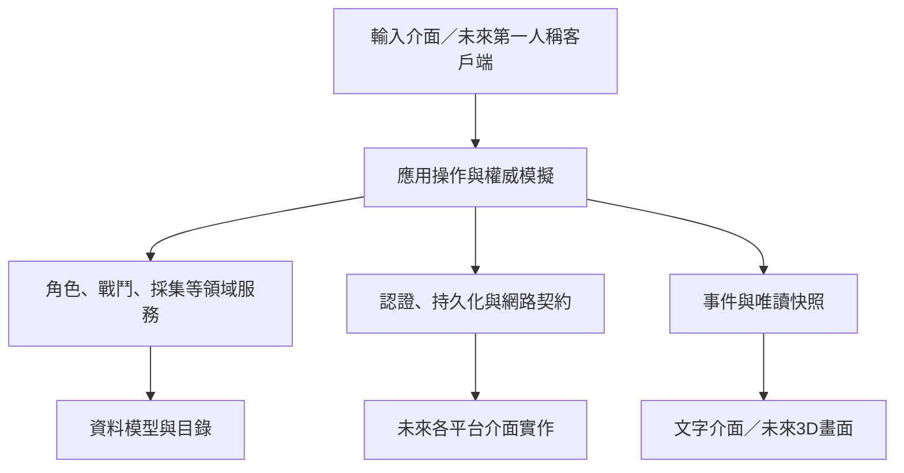

# 先切子系統，再做畫面

## 重建決定

舊版的 `game.js` 混合輸入、UI、遊戲狀態、場景與同步；Worker 又維護部分相同規則。本版重新建立 C++ 型別與服務，不承接舊執行架構。保留的只有可核對的內容 ID、靜態資料與素材。

資料與規則層不依賴任何畫面引擎。未來第一人稱客戶端只送「我要攻擊某目標」，不送「怪物請扣 500 HP」。權威模擬層決定命中、傷害、掉落與狀態變更，再將事件交給渲染與動畫。

## 子系統邊界

| 子系統 | 擁有的資料 | 接受的操作 | 輸出的結果 | 不該做的事 |
|---|---|---|---|---|
| 身分與權限 | Account、Session、Role | 驗證登入、授權 | VerifiedAccount | 讓客戶端指定管理員身分 |
| 角色 | Player、Vitals | 建立、扣血、回復、死亡 | 角色快照 | 畫血條、傳 HTTP |
| 物品與裝備 | Definition、Instance、背包、裝備欄 | 新增、穿戴、消耗、存取 | 衍生能力 | 發放任意世界王獎品 |
| 戰鬥 | 冷卻、傷害、貢獻 | 普攻、技能、怪物攻擊、PvP | Damage、MonsterDied | 顯示刀光、直接存資料庫 |
| 成長與職業 | 等級、XP、職業、隱藏條件 | 加經驗、轉職、刷新能力 | 升級後能力 | 公開未解鎖隱藏職業 |
| 獎勵 | Reward、已處理事件 ID | 建立計畫、領取 | RewardClaimed | 先 ACK 再存角色 |
| 採集 | 資源節點、預約、熟練度 | 開始、完成、取消 | GatherCompleted | 從裝飾樹直接給木材 |
| 製作 | Recipe、城市／工作站需求 | 檢查、扣材料、產物 | Crafted | 相同材料扣兩次 |
| 任務 | QuestDefinition、Progress | 接取、記錄、交付 | XP／金幣 | 讓畫面直接把任務改完成 |
| 副本 | Run、守衛／機關／首領／寶箱 | 進入、互動、開箱、離開 | 通關事件 | 控制外部場景渲染 |
| 經濟 | 金幣、價格、倉庫 | 購買、轉帳、存取 | 餘額變動 | 接受負數或無限數量 |
| 世界與移動 | 位置、場景、樓層、地面 | 移動、落地、進城 | 位置／摔落結果 | 只按城市平面範圍決定腳底樓板 |
| NPC | ID、角色、互動錨點 | 公會／鍛造／商店互動 | 可用服務 | 把模型名稱當作授權條件 |
| 社交 | Party、邀請、成員 | 建隊、邀請、加入、離隊 | 隊伍狀態 | 未邀請就強行加隊 |
| 管理 | Role、功能旗標、稽核 | 發管理員、切 PvP、瞬移 | AdminEvent | 客戶端自行提升權限 |
| 持久化 | 角色版本、獎勵去重、資料交易 | 讀取、版本比對寫入 | 存檔成功／衝突 | 包含遊戲規則與 UI |
| 呈現 | 快照、鏡頭、模型、動畫、設定 | 顯示、輸入映射 | Command | 直接改 HP、物品與金幣 |

## 依賴方向

C++ 核心只能依賴標準函式庫。`main.cpp` 可以替換；換成 Unreal、其他原生引擎或獨立伺服器時，領域服務不搬進輸入／渲染事件中。

## 一次命令的邊界

1. 目前可由CLI或C++工作站HTTP呼叫。工作站Session將權威角色與請求去重綁定；正式OAuth與角色資料版本交易仍待接線。
2. 查詢權威角色、NPC、目標、場景，驗證全部前置條件。
3. 先在副本資料上完成會失敗的數量與能力檢查，再提交資料變更。
4. 建立事件。未來持久化介面必須在同一交易寫入角色、獎勵去重紀錄與發送佇列。
5. 發送結果給客戶端，由畫面決定播放什麼動畫。

World仍由單程序順序模擬；0.2.0已在GameRuntime加入權威HTTP、角色綁定、輸入序號、請求去重、世界JSON保存與重啟。這不是SQL交易或跨程序鎖。ports.hpp保留作為正式認證、資料庫與引擎整合的契約。
