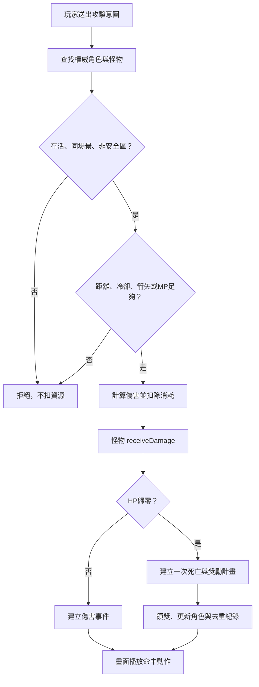

# 先定義操作與流程，再決定畫面動作

## 玩家攻擊怪物



現有程式操作：

```cpp
player.attackIntent();                       // 角色自身檢查
CombatSystem::attack(world, catalog, playerId, monsterId);
monster.receiveDamage(calculatedDamage);      // 由戰鬥服務呼叫
RewardSystem::claim(world, player, rewardId, catalog);
```

不要由輸入介面直接呼叫 `monster.receiveDamage(玩家填入的數字)`。這些資料物件只在權威核心內使用。領域核心檢查距離，0.2.0工作站再檢查前方與建物遮擋。精確膠囊、近戰扇形與弓箭彈道仍是後續增量。

普攻新基準：職業基礎攻擊＋每級3攻擊＋裝備與套裝，減防後至少1傷害。法師普攻另乘0.32並消耗2 MP；弓箭消耗一支指定箭。暴擊率目前會算入 Stats，但尚未抽樣暴擊。職業技能的召喚、汲取、連鎖與箭矢增益尚未接入。

## 採集與砍樹

1. `GatheringSystem::begin` 檢查角色存活、相同場景、距離4公尺、資源重生、熟練度與工具階級。
2. 建立節點預約，記錄完成時間；木材節點是樹，不走徒手拾取。
3. 等待 `seconds`，由權威時間前進；完成後還有15秒操作寬限。
4. `finish` 再檢查全部條件，加入一份材料、增加熟練度、發出任務紀錄、解除預約，節點30秒後重生。
5. `cancel` 只允許預約者取消；逾時預約可由下次 begin 清除。

這裡的 ResourceNode 已與畫面樹木分離。未來伐木動畫、樹倒、樹皮音效只訂閱 GatherStarted／GatherCompleted，不擁有給物品的權限。不是把所有環境裝飾樹都自動視為資源樹。

## 製作與鍛造

`CraftingSystem::craft(world, player, recipeId, npcId, catalog)`：

1. 找到配方，檢查存活與工作站。
2. smith 配方必須位於真正存在的鍛造 NPC 8公尺內，不能由客戶端自報城市。
3. 二階以上裝備依武器類型決定城市：staff→astral、sword→cinder、bow→verdant；共用防具依製作者職業決定。
4. 檢查材料；遊俠系製箭成本減半並向上取整。
5. 在角色複本扣材料並建立物品／工具／消耗品，再提交複本，避免失敗時只扣一半。
6. 發出 Crafted，畫面才播放鍛造與取得物品動作。

基礎配方沿用內容 ID，但實作為新的 C++ 操作；沒有呼叫舊 JavaScript 的 craftCost。

## 轉職與隱藏條件

`ProgressionSystem::changeClass`：公會 NPC 距離→等級→已取得前置職業→隱藏條件→首次轉職材料→取得職業→更換當前職業→卸下不合武器→刷新能力。

已取得職業再次切換不重複扣材料。隱藏條件在模型內保存，CLI 的職業目錄會過濾未解鎖職業；未來網路快照也必須執行同樣的隱私過濾。

目前僅重建基本父職業規則，沒有完整移植舊版牧師跨分支特例、各隱藏傳承試煉獎勵與全部故事劇情。

## 副本

| 狀態／操作 | 前置條件 | 變更 |
|---|---|---|
| enter | 在世界、存活、足夠等級、入口8m內 | 建 Run、保存返回點、建立守衛與首領 |
| 擊殺守衛 | 一般戰鬥條件 | guardsRemaining 減1，不可重複 |
| interactObjective | 守衛全清、合法 objective_1..3、尚未操作 | seals／braziers需3個，relic／rescue需1個，hunt不需要 |
| 攻擊首領 | 守衛全清、機關已滿 | 才能造成傷害 |
| openChest | 首領死亡、目標完成、尚未領取 | 通關獎勵、技能／隱藏條件、任務紀錄 |
| leave | Run 屬於此玩家 | 清除該 Run 怪物、回原位置 |

0.2.0已加入共享Run；入口8m內且符合條件的隊友共同進入，機關與寶箱需要實際靠近。各成員有各自chestClaimed與返回位置，最後成員離開才移除Run。定時入口、隨機佈局、完整導航與跨服尚未完成。

## 世界王與領獎

死亡時取實際造成傷害的玩家，以有效傷害高者優先、相同則依角色 ID 排序。共享件數為 `min(3, ceil(有效參與人數 / 4))`，沒有命中者不分裝；每件至少稀有。這是本次新核心明確採用的確定性基準，與舊版抽籤方式不同。

每位參與者都有自己的 Reward 事件；領取時檢查擁有權與 `processedRewards`，把物品、XP、金幣與去重一起更新到角色複本。單程序內事件重播不重領。0.2.0工作站會將角色、物品、世界王與獎勵去重一起寫入版本化世界檔，並有重啟驗證；這仍不是正式跨節點資料庫交易。

## PvP、隊伍與權限

- PvP 開關預設關閉。啟用後檢查同場景、雙方存活、非安全區、非同隊、距離、冷卻與武器消耗，再扣對方真實 Vitals.hp。沒有另一套固定150HP。
- 隊伍：create→invite→join；需要隊長邀請，一人只可加入一隊，上限5人。離隊會遞補隊長或移除空隊伍。
- 管理：Owner 才能 grantAdmin；Admin／Owner 才能 setPvp 與 teleportToCity；每次成功操作建立稽核事件。這些 API 假設 actorAccount 已由受信任認證取得，目前沒有 OAuth 或公開管理入口。
- 聊天、拍賣市場、玩家物品交易與共享副本尚未實作，不會回傳假的成功訊息。

## 移動、體力、死亡與摔落

- 步行5m/s，奔跑8m/s加裝備移速；每次 move 最多1秒，不能用傳入座標跳到遠方。
- 體力初始100，每級上限+2，封頂200；奔跑每秒18，延遲2秒回復，每秒12，耗盡後到20%才解除鎖定。同一時間戳不重複結算。
- 摔落：6m內安全、空中不足0.6秒不傷；超過每公尺3點，上限180且不超過maxHP的35%；低血量仍能摔死。
- 0.2.0已有C++重力與樓層解算：Motion計算真正落差及滯空，geometry提供樓板／斜坡，升降台到站先更新腳底與接地。這是新程序化場景的實作，並非原版全部幾何完全還原。
- 死亡後需 respawn；扣目前升級需求10% XP，回最後城鎮，恢復 HP／MP。這是新基準，尚未移植舊版經驗不足時的降級規則。

## 存讀檔

CLI save 先領取當前記憶體中屬於自己的獎勵，再保存新 AWCHAR 角色檔。load 先完整解析、驗證版本／集合上限／裝備參照／能力範圍，成功後才替換角色。存檔保留原角色 ID 與物品 ID；CLI 也推進實例序列避免讀回後立刻撞號。

新格式只面向本機原型。上述是AWCHAR1角色檔限制。工作站world-v2.json會保存冷卻、世界王、隊伍、共享Run、管理角色、待領事件與請求去重；仍不宣稱是正式分散式MMO保存方案。
